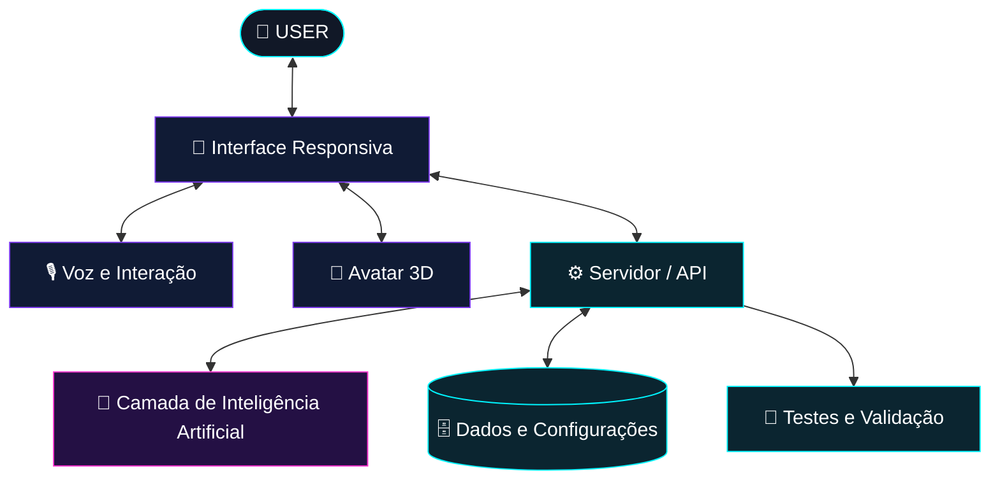

# ⚡ NICOLAS HOLANDA | AI & SOFTWARE ENGINEERING

<div align="center">


<br/>

<a href="https://github.com/nicolasholanda8818-crypto">

</a>


</div>

---

## `01 // SYSTEM PROFILE`

```python
class NicolasHolanda:
    def __init__(self):
        self.role = "IT Management Student"
        self.focus = [
            "Artificial Intelligence",
            "Python Development",
            "Software Engineering",
            "Databases & Automation"
        ]
        self.current_mission = "Build useful technology"
        self.mindset = "Learn. Build. Improve. Repeat."

    def introduce(self):
        return "Turning ideas into digital solutions."

me = NicolasHolanda()
```

🎓 Estudante de **Gestão da Tecnologia da Informação**, com interesse em desenvolvimento de software, inteligência artificial, automação e criação de soluções digitais.

🚀 Meu objetivo é transformar conhecimento em projetos práticos, evoluindo continuamente como desenvolvedor.

---

## `02 // TECHNOLOGY MATRIX`

<div align="center">

### ⚙️ Linguagens & Desenvolvimento


### 🗄️ Dados, Ferramentas & Ambiente


</div>

> Tecnologias exibidas representam ferramentas de estudo e interesse. A experiência prática varia conforme cada projeto.

---

## `03 // PROJECTS UNDER DEVELOPMENT`

<details>
<summary><b>🤖 ORION 2.0 — AI ASSISTANT</b></summary>

<br/>

**Visão:** evoluir um assistente de inteligência artificial com uma experiência mais natural, interface moderna e possibilidade de interação por voz e avatar 3D.

**Direções do projeto:**
- 🧠 Integração com modelos de IA.
- 🎙️ Exploração de interação por voz.
- 🧍 Avatar 3D com interface responsiva.
- 💻 Experiência adaptada para diferentes dispositivos.
- 🔧 Melhorias graduais, testes e correções.

**Status:** projeto em evolução. Os recursos dependem da implementação e dos testes realizados.

🔗 **[Acessar repositório do Orion](https://github.com/nicolasholanda8818-crypto/assistente-orion)**

</details>

<details>
<summary><b>🛍️ MANDA PRINT — PERSONALIZAÇÃO DIGITAL</b></summary>

<br/>

**Visão:** desenvolver a presença digital de uma marca de produtos personalizados, com foco em uma experiência de compra simples e visual moderno.

**Áreas de desenvolvimento:**
- 🎨 Identidade visual e apresentação de produtos.
- 🛒 Experiência de navegação para clientes.
- 📦 Organização de produtos e catálogo.
- 📱 Interface adaptável para celular e computador.

**Status:** projeto em desenvolvimento. Funcionalidades disponíveis devem ser conferidas diretamente no repositório público.

🔗 **[Explorar repositórios públicos relacionados à MANDA PRINT](https://github.com/nicolasholanda8818-crypto?tab=repositories)**

</details>

<details>
<summary><b>🐍 PYTHON, DADOS & AUTOMAÇÃO</b></summary>

<br/>

Estudos e projetos práticos para desenvolver lógica de programação, trabalhar com dados e criar soluções usando Python.

**Focos de aprendizagem:**
- Python e desenvolvimento de aplicações.
- SQL e fundamentos de banco de dados.
- APIs, automação e integração de sistemas.
- Organização, legibilidade e manutenção de código.

🔗 **[Ver meus repositórios](https://github.com/nicolasholanda8818-crypto?tab=repositories)**

</details>

---

## `04 // ORION 2.0 — SYSTEM ARCHITECTURE`



<sub>Diagrama conceitual da arquitetura desejada. Ele não representa uma confirmação de que todos os módulos já estejam implementados ou conectados.</sub>

---

## `05 // GITHUB ACTIVITY`

<div align="center">


<br/>


</div>

---

## `06 // NEXT OBJECTIVES`

<div align="left">

- [ ] Aprimorar meus projetos em Python.
- [ ] Aprofundar conhecimentos em SQL e bancos de dados.
- [ ] Evoluir em engenharia de software.
- [ ] Explorar aplicações práticas de inteligência artificial.
- [ ] Melhorar arquitetura, testes e documentação dos projetos.
- [ ] Construir um portfólio cada vez mais consistente.

</div>

---

## `07 // CONNECT TO MY UNIVERSE`

<div align="center">

<a href="https://github.com/nicolasholanda8818-crypto">

</a>

<br/><br/>

**💡 Building the future, one project at a time.**

<sub>Curiosity is the beginning. Practice is the evolution.</sub>


</div>
