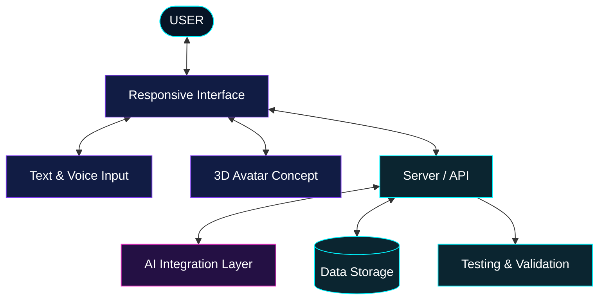

 <div align="center">


<br/>


</div>

---

## `01 // DEVELOPER IDENTITY`

<div align="center">


### NIKO.exe — DIGITAL EXPLORER

*Curiosity is the interface. Knowledge is the system. Innovation is the mission.*

</div>

```python
class NicolasHolanda:
    def __init__(self):
        self.education = "Information Technology Management"
        self.interests = [
            "Artificial Intelligence",
            "Python Development",
            "Software Engineering",
            "Databases & Automation"
        ]
        self.mindset = "Learn by building"
        self.mission = "Create useful digital solutions"

    def next_level(self):
        return "Learn, build, test, improve"

developer = NicolasHolanda()
```

I'm an Information Technology Management student interested in software development, artificial intelligence, databases, and automation.

I enjoy exploring new technologies, turning ideas into practical projects, and improving my skills through hands-on learning.

**My goal:** build reliable, useful, and thoughtfully designed digital solutions while growing as a software developer.

---

## `02 // THE TECHNOLOGY MATRIX`

<div align="center">

### 💻 Foundations & Tools


### 🚀 Technologies to Explore & Deepen


</div>

| Track | Current direction |
|---|---|
| **Programming** | Python, problem-solving, and application development |
| **Web Development** | HTML, CSS, JavaScript, and responsive interfaces |
| **Databases** | SQL, data organization, and database fundamentals |
| **Developer Tools** | Git, GitHub, VS Code, and project documentation |
| **Artificial Intelligence** | Exploring AI integrations and intelligent assistants |
| **Software Engineering** | Architecture, testing, maintainability, and good practices |

<sub>These icons represent technologies studied or targeted for further learning. They do not imply professional proficiency in every listed tool.</sub>

---

## `03 // FEATURED PROJECTS`

<details open>
<summary><b>🤖 ORION 2.0 — AI ASSISTANT</b></summary>

<br/>

**Category:** Artificial Intelligence · Personal Project

An evolving AI assistant project focused on a modern interface and a more natural, personalized user experience.

**Project directions**
- AI model integration and assistant interactions.
- Exploration of voice-based interaction.
- A concept for a 3D digital avatar.
- Responsive experiences across different devices.
- Incremental improvements, testing, and debugging.

**Status:** In development. Individual features depend on implementation and validation.

[](https://github.com/nicolasholanda8818-crypto/assistente-orion)

</details>

<details open>
<summary><b>🛍️ MANDA PRINT — PERSONALIZED PRODUCTS</b></summary>

<br/>

**Category:** Digital Business · E-commerce Concept

A project connected to the digital presence of a personalized-products brand, with an interest in product presentation and a user-friendly shopping experience.

**Project directions**
- Product catalog and visual presentation.
- Modern, responsive interface design.
- Exploration of e-commerce workflows.
- Clear and accessible customer journeys.

**Status:** Project work and repository contents should be reviewed individually before treating specific features as complete.

[](https://github.com/nicolasholanda8818-crypto?tab=repositories)

</details>

<details>
<summary><b>🐍 PYTHON, DATA & AUTOMATION</b></summary>

<br/>

A collection of programming studies and practical exercises focused on building stronger development fundamentals.

**Learning directions**
- Python programming and problem-solving.
- SQL and database fundamentals.
- APIs and service integration.
- Automation and data processing.
- Code organization and documentation.

[](https://github.com/nicolasholanda8818-crypto?tab=repositories)

</details>

---

## `04 // ORION 2.0 — SYSTEM BLUEPRINT`



<sub>Conceptual target architecture, not a claim that every component is currently implemented or connected.</sub>

---

## `05 // GITHUB ANALYTICS`

<div align="center">


<br/>


</div>

<sub>Statistics are provided by external services and may occasionally be unavailable. Repository language percentages do not necessarily reflect skill level.</sub>

---

## `06 // NEXT MILESTONES`

- [ ] Strengthen Python development skills.
- [ ] Build more practical web development projects.
- [ ] Deepen SQL and database knowledge.
- [ ] Improve software architecture and testing practices.
- [ ] Explore practical AI integrations.
- [ ] Document projects clearly and consistently.
- [ ] Develop a portfolio for internship and junior opportunities.

---

## `07 // CONNECT TO THE DEVELOPER`

<div align="center">

<a href="https://github.com/nicolasholanda8818-crypto">

</a>

<br/><br/>

### `BUILD → LEARN → TEST → AUTOMATE → INNOVATE`

*Every great system starts with a first line of code.*


</div>
